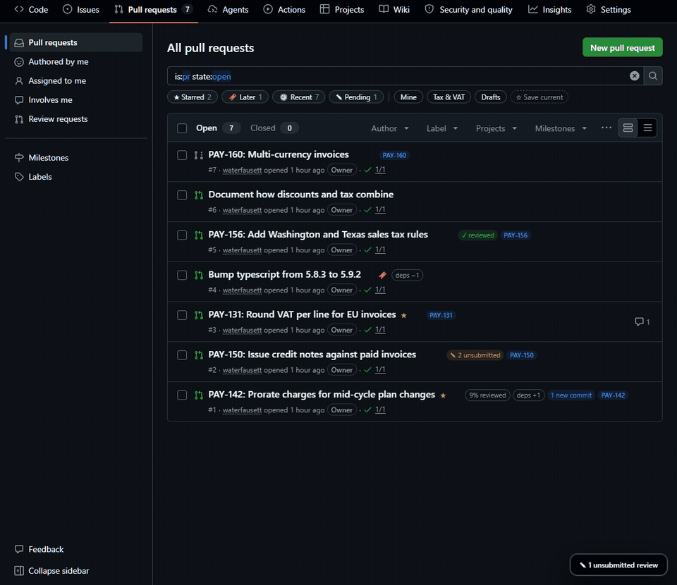
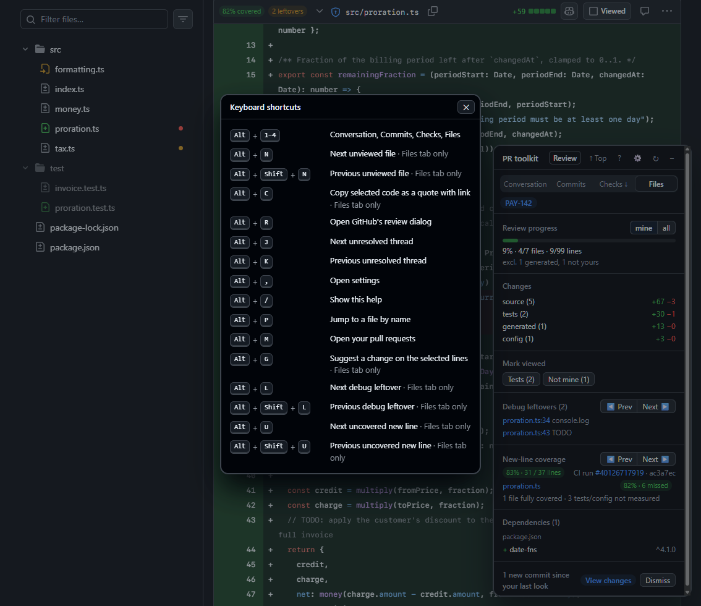
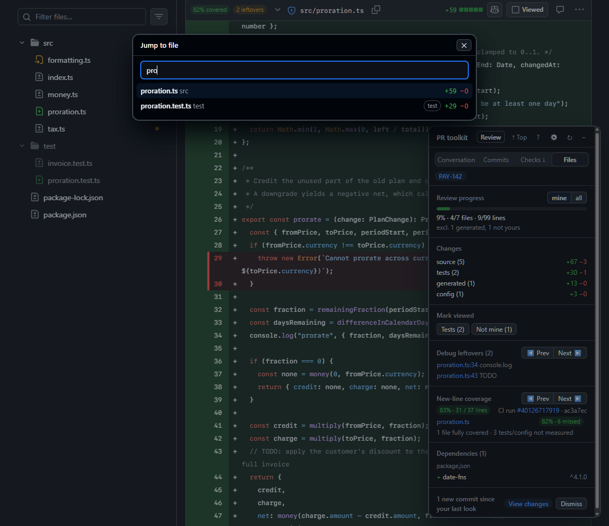
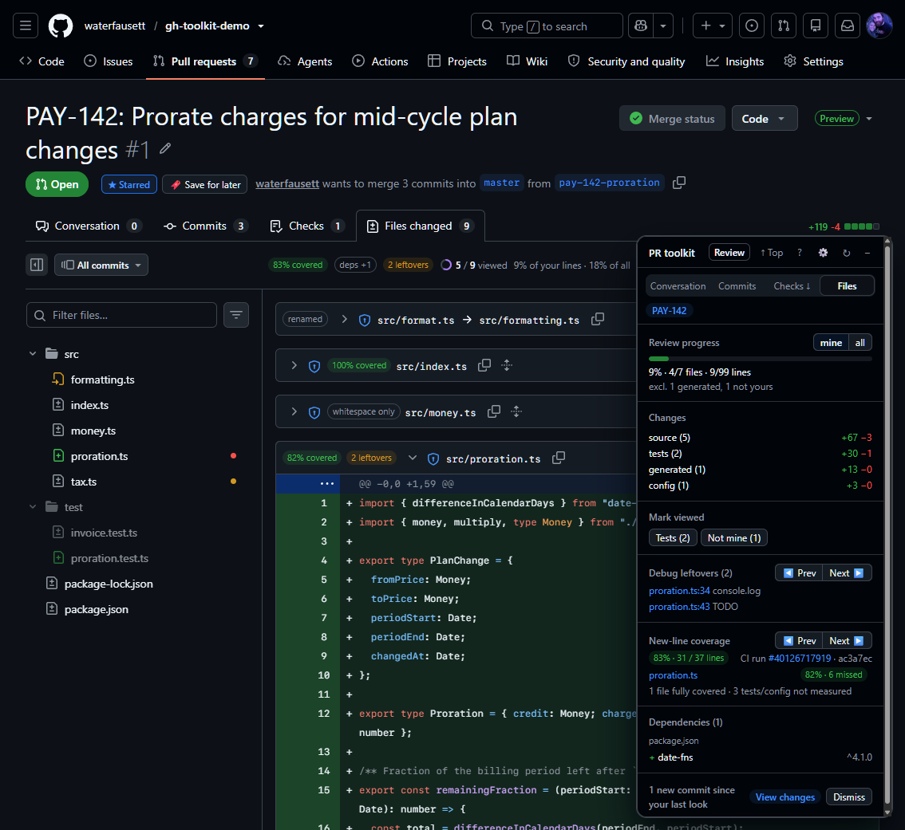
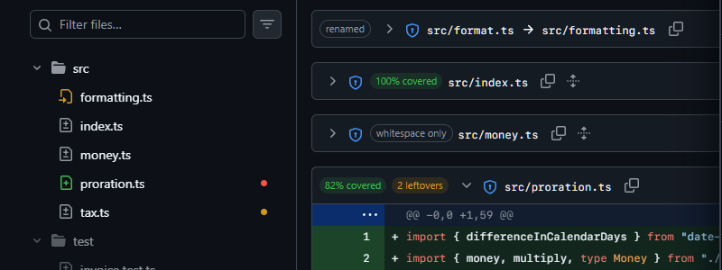
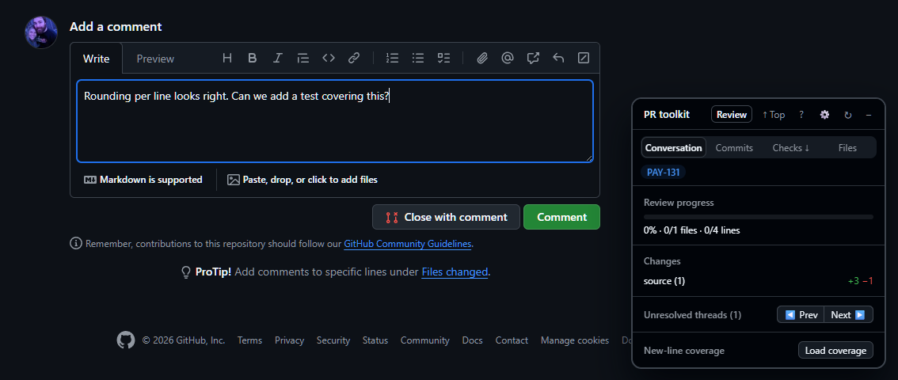
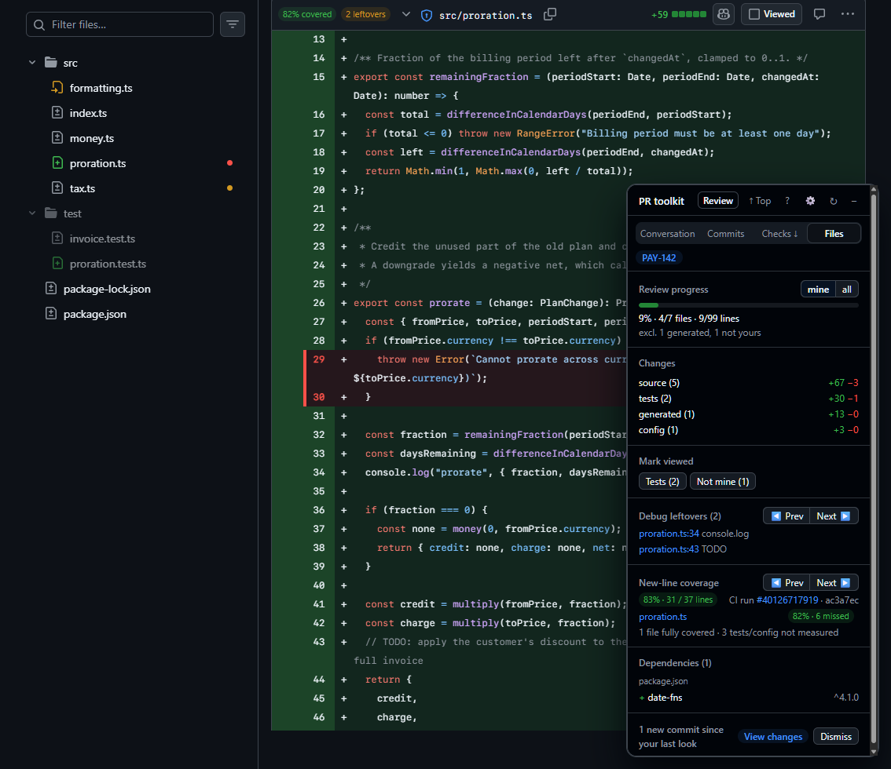
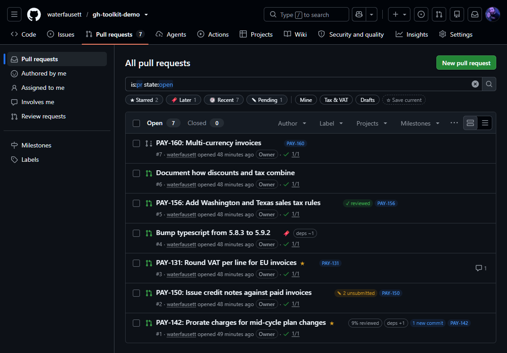

<div align="center">

# 🧰 GitHub PR Review Toolkit

**A Tampermonkey userscript that makes reviewing pull requests on GitHub faster and less noisy.**

A floating panel, per-file helpers and keyboard shortcuts for GitHub PRs.<br>
No token needed: it reads GitHub through your already signed-in browser session.

[](https://raw.githubusercontent.com/waterfausett/gh-toolkit/master/gh-pr-review-toolkit.user.js)

[Install](#-install) · [Setup](#-first-time-setup) · [Shortcuts](#-keyboard-shortcuts) · [Features](#-features) · [How data is loaded](#-how-data-is-loaded) · [Maintenance](#-maintenance-notes)

<br>



</div>

---

## 🚀 Install

1. Install [Tampermonkey](https://www.tampermonkey.net/).
2. Open [gh-pr-review-toolkit.user.js](https://raw.githubusercontent.com/waterfausett/gh-toolkit/master/gh-pr-review-toolkit.user.js) and click **Install**.
3. Open a PR. Tampermonkey will ask to allow connections to `github.com`, `raw.githubusercontent.com`, `patch-diff.githubusercontent.com` and `blob.core.windows.net` (where GitHub serves Actions artifacts, for new-line coverage); allow them.

### 🔄 Updates

Installed scripts update themselves from this repo through `@updateURL`. Tampermonkey checks on its own schedule (Settings → Script Update), or immediately from Dashboard → "Check for userscript updates".

> [!IMPORTANT]
> Tampermonkey only updates when `@version` increases. A GitHub Action bumps the patch version of every changed script on each push to `master`; bump `@version` yourself in the same push for a minor or major release, and the action will leave that script alone.

Config is kept in Tampermonkey storage and survives updates. Edits made in the Tampermonkey editor are overwritten by the next update, so make changes in the repo.

## 🔑 First-time setup

Set `myOwners` to the CODEOWNERS teams you belong to, or files owned by your teams will be marked as owned by others. Your own GitHub login is picked up automatically, so only teams need listing.

Open the Tampermonkey menu, choose **Edit config (JSON)**, and edit the array:

```json
"myOwners": ["my-org/my-team"]
```

Use the same `org/team` form that appears in CODEOWNERS. The panel can't look up your memberships itself because that needs a GitHub API token.

> [!TIP]
> If the Linear and ADO ticket chips don't link as expected, see `ticketRules` and `adoBase` in the same config.

Every feature has a toggle in the settings modal, opened with the ⚙ in the panel bar or <kbd>Alt</kbd>+<kbd>,</kbd> (grouped, with a Reset to defaults button). **Edit config (JSON)** and **Reset config** are in the Tampermonkey menu; only settings you change are stored.

## ⚡ Keyboard shortcuts

| Keys | Action |
|---|---|
| <kbd>Alt</kbd>+<kbd>1</kbd> … <kbd>4</kbd> | Conversation / Commits / Checks / Files |
| <kbd>Alt</kbd>+<kbd>R</kbd> | Open GitHub's review dialog |
| <kbd>Alt</kbd>+<kbd>P</kbd> | Quick file jump |
| <kbd>Alt</kbd>+<kbd>M</kbd> | Your pull requests in the current repo |
| <kbd>Alt</kbd>+<kbd>N</kbd> / <kbd>Alt</kbd>+<kbd>Shift</kbd>+<kbd>N</kbd> | Next / previous unviewed file |
| <kbd>Alt</kbd>+<kbd>J</kbd> / <kbd>Alt</kbd>+<kbd>K</kbd> | Next / previous unresolved thread |
| <kbd>Alt</kbd>+<kbd>L</kbd> / <kbd>Alt</kbd>+<kbd>Shift</kbd>+<kbd>L</kbd> | Next / previous debug leftover |
| <kbd>Alt</kbd>+<kbd>U</kbd> / <kbd>Alt</kbd>+<kbd>Shift</kbd>+<kbd>U</kbd> | Next / previous uncovered new line |
| <kbd>Alt</kbd>+<kbd>C</kbd> | Copy selected code as a quote with a link |
| <kbd>Alt</kbd>+<kbd>G</kbd> | Turn selected lines into a suggestion comment |
| <kbd>Alt</kbd>+<kbd>/</kbd> | Show enabled shortcuts |
| <kbd>Alt</kbd>+<kbd>,</kbd> | Settings |



## ✨ Features

Click any feature for the details.

### 🧭 Navigation



<details>
<summary><b>Always-visible tab nav</b> — Conversation / Commits / Checks / Files in the panel</summary>
<br>

<kbd>Alt</kbd>+<kbd>1</kbd>..<kbd>4</kbd>. By default **Checks ↓** scrolls to the merge box's checks summary on the Conversation tab (going there first if you're on another tab); turn on "Checks nav item opens the Checks tab" in settings to open the tab instead. The title bar also has a ↑ Top button that stays put when the panel is collapsed. Handles both `/files` and `/changes`. Plain clicks navigate in-page by clicking a real link so GitHub's own router handles it; if the URL hasn't changed after 1.5s the script falls back to a full page load.
</details>

<details>
<summary><b>Review button</b> — opens GitHub's review dialog from any tab</summary>
<br>

**Review** in the panel bar, or <kbd>Alt</kbd>+<kbd>R</kbd>. Clicks GitHub's own "Review changes" / "Submit review" button so its review dialog opens; it never submits anything. From another tab it goes to Files first and waits up to 10s for the button to render (the pending jump survives the full-load fallback, like Checks ↓). Buttons inside a form or dialog are skipped, so the dialog's own submit button is never clicked.
</details>

<details>
<summary><b>My PRs</b> — jump to the pull requests you authored</summary>
<br>

<kbd>Alt</kbd>+<kbd>M</kbd> on any GitHub page (not just PRs). Opens `/<org>/<repo>/pulls/<your login>` for the repo you are in, with the repo and login read from the page. Outside a repo it opens GitHub's global `/pulls` instead. Leaving a PR this way still goes through the unsubmitted-review warning.
</details>

<details>
<summary><b>Quick file jump</b> — fuzzy file finder</summary>
<br>

<kbd>Alt</kbd>+<kbd>P</kbd> on any PR tab opens a file finder. Type part of a name: matching is fuzzy (letters in order), with file-name matches ranked above matches that only work across the whole path. Each row shows +/− counts and the same markers as the tree: blue dot changed since viewed, amber dot owned by others, ✓ viewed, and a generated / test tag. Arrow keys move, Enter jumps, Esc closes. The jump scrolls to the file and expands it if it was collapsed. A file GitHub hasn't rendered yet gets its `#diff-<sha256>` anchor set as the hash, the way the file tree's own links work. From another tab it goes to Files first, and the pending jump survives the full-load fallback like Checks ↓.
</details>

<details>
<summary><b>Next / previous unviewed file</b> — skip straight to what's left</summary>
<br>

<kbd>Alt</kbd>+<kbd>N</kbd> jumps to the next file whose Viewed box is unticked, <kbd>Alt</kbd>+<kbd>Shift</kbd>+<kbd>N</kbd> to the previous one. Files collapsed as generated, test, whitespace-only or renamed, and files hidden by a filter, are skipped. Wraps around. Files GitHub hasn't rendered yet are not visible to it.
</details>

<details>
<summary><b>Unresolved thread navigator</b> — hop between open threads</summary>
<br>

Panel buttons, or <kbd>Alt</kbd>+<kbd>J</kbd> / <kbd>Alt</kbd>+<kbd>K</kbd>.
</details>

<details>
<summary><b>Keyboard shortcut help</b> — lists every enabled shortcut</summary>
<br>

Click **?** in the panel bar or press <kbd>Alt</kbd>+<kbd>/</kbd> to list every shortcut that is currently enabled. Esc, ✕ or a click outside closes it.
</details>

### 📊 Review progress



<details>
<summary><b>Review progress meter</b> — line-weighted progress bar on every PR tab</summary>
<br>

Top of the panel on every PR tab: a bar plus `62% · 9/14 files · 410/660 lines`. The percentage is weighted by changed lines (additions + deletions). By default generated files and files owned by others (CODEOWNERS, when ownership is on) are left out and listed as "excl. 3 generated, 5 not yours"; **mine / all** switches scope (remembered across PRs).

On the Files tab a file's own Viewed control decides. Elsewhere, and for files GitHub hasn't rendered, a file counts as viewed only if the blob SHA recorded when you ticked it matches the current one. The Files tab also brings those records in line with what GitHub shows, so files ticked before installing or on another machine count after one visit to Files.

On the Files tab a line-progress chip also sits after GitHub's own "N / M viewed" counter, even with the panel collapsed: "62% of your lines · 48% of all" when files are left out of your share, otherwise "48% of lines". Hover it for file and line counts.
</details>

<details>
<summary><b>Viewed-state across pushes</b> — know which viewed files changed again</summary>
<br>

Records the file's blob SHA when you tick Viewed (the checkbox, or the newer diff's Viewed button). After a push, files whose SHA differs get a badge, a blue dot in the left file tree (hover for the reason), and are listed in the panel.
</details>

<details>
<summary><b>"Changed since viewed" filter</b> — show only files that changed after you viewed them</summary>
<br>

Adds a **Changed since viewed (N)** checkbox to GitHub's own file tree filter menu, under "Viewed files". It only appears while N > 0. When ticked, the diff and the file tree show only those files (folders with none are hidden), combined with GitHub's own filters. It turns itself off once you've re-viewed them all. The choice is remembered per PR.
</details>

<details>
<summary><b>New commits since your last look</b> — one click to the range diff</summary>
<br>

Your last look is the PR's head commit when you last marked a file Viewed. When the head has moved since, the panel shows "N new commits since your last look" with **View changes**, which opens GitHub's own range view (`/pull/<n>/files/<old>..<new>`). After a force-push the old commit isn't in the PR and that view 404s, so it links to `/compare/<old>..<new>` instead and says so. **Dismiss** marks the current head as seen.
</details>

<details>
<summary><b>Bulk mark viewed</b> — tick generated, test or not-mine files in one go</summary>
<br>

Files tab only. **Mark viewed** buttons for generated, test and not-mine files, each showing how many are still unviewed (hidden at 0). They click GitHub's own Viewed controls, 150ms apart, so GitHub saves the state. Files GitHub hasn't rendered yet have no control; the toast says how many were skipped ("Marked 7 viewed; 3 not loaded yet — scroll down and run again").
</details>

### 🧹 Less noise



<details>
<summary><b>Collapse test and generated files</b></summary>
<br>

Finds each file's path from its header (verified against the container's `diff-<sha256>` id) and clicks GitHub's own chevron, so the chevron expands it again. Files you expand stay expanded across refreshes. If no chevron is found, the script hides the body itself and adds a toggle button. Patterns: `generatedPatterns`; tests are `tests/`, `__tests__/`, `*.test.*`, `*.spec.*`, `*_test.py`, `test_*.py`.
</details>

<details>
<summary><b>Collapse whitespace-only and rename-only files</b></summary>
<br>

Pure renames (`similarity index 100%`, no hunks, no mode change) get a **renamed** badge; files where every hunk's old and new text match once all whitespace is removed get **whitespace only** (the same rule as `?w=1`, so re-indents, re-wrapped lines and blank-line or trailing-newline changes count, but moved lines don't). Both collapse like generated files and stay expanded once you expand them. Binary files and mode changes never count.
</details>

<details>
<summary><b>Dim test files in the tree</b></summary>
<br>

Dims test files and folders in the left file tree. Paths are rebuilt from the tree's nested labels, so compacted folders work.
</details>

<details>
<summary><b>Mark files owned by others</b> — CODEOWNERS-aware amber dots</summary>
<br>

CODEOWNERS, last matching rule wins. "Mine" is your login or any `myOwners` team. In the left file tree, files owned by others get an amber dot before the name (hover for the reason). Turn it off in settings. `minePatterns` (regexes) can mark extra paths as yours.
</details>

<details>
<summary><b>Hide bot comments</b></summary>
<br>

Conversation tab timeline items authored by bots.
</details>

<details>
<summary><b>Whitespace hidden by default</b></summary>
<br>

Off by default. Redirects to `?w=1` once per tab per PR, and never when the URL already has a `w` parameter.
</details>

### ✍️ Writing reviews



<details>
<summary><b>Suggestion from selection</b> — selected lines → <code>```suggestion</code> comment</summary>
<br>

Select lines on the new side of a diff and press <kbd>Alt</kbd>+<kbd>G</kbd>. Opens a review comment on those lines (clicks the first line number, shift-clicks the last, then GitHub's "+" button) and puts a ` ```suggestion ` block with the selected lines in it. Whole lines are used even if the selection starts or ends mid-line; diff markers and line numbers are left out; deleted lines are skipped. It never posts the comment. If the comment form doesn't open, the block is copied to the clipboard instead. If GitHub's form doesn't confirm the multi-line range, a toast asks you to check it before posting. Selections that are only deleted lines, or that span hunks, are refused with a toast.
</details>

<details>
<summary><b>Copy quote with link</b> — Markdown link + fenced code</summary>
<br>

Select code in a diff and press <kbd>Alt</kbd>+<kbd>C</kbd>. Copies a Markdown link to the file and selected lines (`…/files#diff-<id>R10-R12`, `L` for removed lines) followed by the code in a fenced block. If line numbers can't be read it still copies the code with a link to the file.
</details>

<details>
<summary><b>Snippet expander</b> — <code>;nit</code>, <code>;lgtm</code> and friends</summary>
<br>

Type `;nit` then space in any comment box. Defaults: `;nit`, `;q`, `;block`, `;lgtm`, `;test`, `;why`. Edit via **Edit config (JSON)**.
</details>

<details>
<summary><b>Warn before leaving with an unsubmitted review</b></summary>
<br>

If your pending review has comments, closing the tab, reloading or following a link off the PR asks first. Same-site links that leave the PR (another PR, issues, a file view) get a `confirm()`; anything else that unloads the page gets the browser's own "Leave site?" prompt. Moving between the PR's own tabs, clicking Submit in the review dialog, and F5 / Ctrl+R don't prompt (the browser's reload button does). A pending review with no comments, or your submitted comments, never count. Browser back/forward inside GitHub's app is not caught, and nor is closing the tab within 10s of clicking a link inside the PR.
</details>

### 🔍 Insights



<details>
<summary><b>Change stats</b> — additions and deletions by category</summary>
<br>

Additions and deletions by category (source, tests, docs, config, generated).
</details>

<details>
<summary><b>Debug leftovers</b> — flags <code>console.log</code>, <code>debugger</code>, <code>TODO</code> and more</summary>
<br>

Scans added lines (not generated or whitespace-only files) against `leftoverPatterns`: `console.log` / `debugger` / `.only(` in JS/TS, `print(` / `breakpoint()` / `pdb.set_trace(` in Python, `TODO` / `FIXME` anywhere, `localhost` / `127.0.0.1` outside docs, tests and env files. A line is skipped when the same text (ignoring whitespace) was removed in that hunk, so touching an old TODO doesn't flag it.

Files get an **N leftovers** badge (hover for the lines) and the panel lists them. <kbd>Alt</kbd>+<kbd>L</kbd> / <kbd>Alt</kbd>+<kbd>Shift</kbd>+<kbd>L</kbd> (or the list) jumps to the next / previous one: it expands the file if collapsed, scrolls to the line and flashes it. Each pattern is `{ label, pattern, files?, exclude? }` (regex strings; `files` / `exclude` match the path) or a plain regex string.

On the Files tab a **N leftovers** badge also sits before GitHub's "N / M viewed" counter and its progress circle, even with the panel collapsed; click it to jump to the next one.
</details>

<details>
<summary><b>New-line coverage</b> — how much of the code the PR adds is run by tests</summary>
<br>

Reads the Cobertura XML coverage reports your CI already uploads as Actions artifacts, and checks them against the PR's added lines only. Coverage of lines the PR didn't touch is ignored. Reports from several jobs are merged: a line counts as covered if any job ran it. Blank lines, comments and anything else the report doesn't count as code are left out of the percentage.

- Each changed source file gets a **NN% covered** badge (hover for the missed line numbers), or **no coverage data** when no report mentions it. Test, docs, config and generated files get nothing.
- Uncovered new lines are highlighted in red: the new-side line number and the line's code. Hover the line number for "New line not covered by tests". <kbd>Alt</kbd>+<kbd>U</kbd> / <kbd>Alt</kbd>+<kbd>Shift</kbd>+<kbd>U</kbd> jumps between them.
- Files with uncovered new lines or no coverage data get a red dot in the file tree (hover for the count).
- Next to "N / M viewed", a chip answers "how much of this PR's new code is covered?", for example **84% covered**, toned by the threshold. Hover it for the number of uncovered files and lines; click it to jump to the next uncovered line.
- The panel's **New-line coverage** section shows the PR total, the CI run it came from, and the files that need attention, worst first: source files with no data, then files by missed lines.

**When it loads:** opening a PR never downloads anything; coverage already cached for the PR's head commit shows straight away. With **Load coverage automatically on the Files tab** on (the default), artifacts are fetched the first time you open the PR's Files tab. Turn it off to fetch only when you click **Load coverage**, in the panel or in the coverage chip's spot next to "N / M viewed".

Coverage is only computed once every Actions job on the PR's head commit has finished. While CI runs, the panel says it's waiting (in repos where coverage has been seen before) and checks again every minute. Coverage from an earlier commit is never shown on the current diff.

| Config | Default | Meaning |
|---|---|---|
| `coverageArtifactPattern` | `"cov"` | Regex (case-insensitive) an artifact name must match to be downloaded. |
| `coverageThreshold` | `80` | At or above this percentage a badge is green. |
| `coverageWarnMargin` | `10` | Within this many points below the threshold it's amber; below that, red. |

**What CI needs to do:**

- Upload Cobertura XML (pytest-cov's `--cov-report=xml`, or Vitest/Jest's `cobertura` reporter) with `actions/upload-artifact`, in an artifact whose name matches `coverageArtifactPattern`. Artifacts over 50 MB are skipped.
- Check out the PR's head commit, not GitHub's default test-merge commit, or line numbers can drift when the base branch has moved:

  ```yaml
  - uses: actions/checkout@v4
    with:
      ref: ${{ github.event_name == 'pull_request' && github.event.pull_request.head.sha || github.sha }}
  ```

Only Cobertura is read for now. Support for Istanbul's `coverage-final.json` (Vitest with `@vitest/coverage-v8` and the `json` reporter) is planned.

**What's stored:** per PR, one entry with the head commit SHA, a hash of the CI job ids, and per file a salted hash of the path with its measured and missed line numbers. No paths, code or report content. A new head commit replaces the entry, and entries are pruned after 7 days. Each repo where coverage has been found also keeps a timestamp under a salted hash, pruned after 90 days. Downloaded artifacts are read in memory and never saved.
</details>

<details>
<summary><b>Dependency changes</b> — packages added, removed and bumped</summary>
<br>

Panel list of added (+), removed (−) and changed (~) packages per manifest: `package.json` (`dependencies`, `devDependencies`, `peerDependencies`, `optionalDependencies`), `requirements*.txt` / `requirements*.in`, and `pyproject.toml` (`[project]` dependencies, optional-dependencies, `[dependency-groups]`, build requires, Poetry tables). Lockfiles are ignored. See [Maintenance notes](#-maintenance-notes) for how sections are guessed when a hunk doesn't include its header.
</details>

<details>
<summary><b>Ticket chips</b> — Linear and ADO links from the title and branch</summary>
<br>

Own row under the nav. IDs come from the PR title and branch name. `AB#123` is treated as ADO; it links once the script has seen any `…/_workitems/edit/…` link on a page (remembered afterwards) or you set `adoBase`. Any other `ABC-123` is Linear. Branch names match case-insensitively; `ticketIgnorePrefixes` filters look-alikes such as `UTF-8` and `fix-12`. Rules live in `ticketRules`.
</details>

### 🌐 Beyond the PR page



<details>
<summary><b>Review badges in PR lists</b> — progress, new commits and unsubmitted reviews at a glance</summary>
<br>

On PR lists (a repo's Pulls, the global `/pulls`, issue and search results), PRs you've started reviewing get a **62% reviewed** badge (**✓ reviewed** at 100%) after the title. It is a summary saved on your last visit to that PR, not live: hover for files viewed and the mine / all split. It counts your share when CODEOWNERS leaves some files out.

If "New commits since your last look" is on and you have a last look for the PR, a **3 new commits** badge (or **force-pushed**) links to the same range view as the panel. PRs you never marked a file Viewed on show nothing and cost no requests.

A PR where your pending review has comments gets **✎ 3 unsubmitted**, linking to its Files tab. A **✎ N unsubmitted reviews** button at the bottom right of list pages opens every one of them, across repos and pages, newest first. These are saved per visit too: a review you submit from somewhere else stays listed until you next open that PR. Unlike the rest of the stored data, these entries are kept under the plain `owner/repo#n` (never the title) so the list can name them; an entry is removed when you open the PR and it has no pending comments.
</details>

<details>
<summary><b>Ticket chips elsewhere</b> — PR lists, branches and commits</summary>
<br>

The ticket chips also appear after PR titles in lists, after branch names on the branches page, and after commit messages on commit lists and a single commit's page. They use the same `ticketRules`; branch names match case-insensitively like on a PR. Needs "Ticket chips" on as well.
</details>

<details>
<summary><b>Saved searches</b> — one-click filters on a repo's Pull requests page</summary>
<br>

A row of chips under the search box on `/<owner>/<repo>/pulls`. Build a query with the search box or the Author / Label / Reviews menus, click **☆ Save current** and name it; the chip then loads that query, and is highlighted while it's the one applied. Hover a chip for **✎** (rename it or edit the query by hand) and **×** (delete, with Undo). Drag chips to reorder them.

If you open a chip and then change the filters, it gets a **●** and you're offered **↻ Update "name"** (save the new query over it) or **☆ Save as new**.

Each repo has its own list, stored in Tampermonkey storage under the lowercased `owner/repo`, so it stays in that browser and isn't synced between machines.
</details>

<details>
<summary><b>Starred, saved for later, recent and pending</b> — built-in chips for finding PRs in a busy repo</summary>
<br>

A PR's header gets **☆ Star** and **🔖 Save for later** next to its state label (icon-only in the compact header GitHub pins to the top as you scroll), and PR rows in lists get the same two icons on hover (lit when set), so you can mark a PR without opening it. They fill four built-in chips at the front of the saved-searches row, ahead of your own searches:

- **★ Starred**: kept until you unstar it, merged or closed included (`is:pr #a #b …`). Up to 50 per repo; past that you're asked to unstar one first.
- **🔖 Later**: for "I'll review this when I have time". It's dropped once the PR is seen merged or closed, on its own page or as a list row, and the chip's `is:open` hides it before then. Up to 50 per repo. Merged and closed PRs don't offer it.
- **🕘 Recent**: the last 50 PRs you opened in the repo, open ones only (`is:pr is:open #a #b …`). GitHub sorts the results, not by when you viewed them.
- **✎ Pending**: open (including draft) PRs with an unsubmitted review, from the same record as the list badges (needs "Review badges in PR lists").

Each chip is an ordinary query: GitHub's Pull requests search ORs the `#n` refs, so you can open one and add filters. Every chip query ends in `#pr_number_exact_match`: GitHub also adds a full-text match on all the terms, so a lone `#7` would pull in #17 and #77, and a term no PR contains empties that half and leaves only the listed numbers. A chip is hidden while its list is empty, and the count is what's stored, not what GitHub shows. Each list has its own toggle under **PR lists** in the settings. Only the lowercased `owner/repo` and PR numbers are stored, under `prLists`, never titles.
</details>

## 📡 How data is loaded

Up to three requests per PR, plus the coverage requests below, made by Tampermonkey with your GitHub session cookies:

| Request | Used for |
|---|---|
| `/<owner>/<repo>/pull/<n>.diff` | The file list, per-file additions and deletions, and blob SHAs (from the diff's `index` lines). The same pass flags whitespace-only and rename-only files, scans added lines for debug leftovers and reads dependency manifests; only those results are kept, not the diff text. |
| `/<owner>/<repo>/raw/HEAD/.github/CODEOWNERS` | Ownership (falling back to `CODEOWNERS` and `docs/CODEOWNERS`). |
| `/<owner>/<repo>/pull/<n>/commits` | With `Accept: application/json`, for the PR's commit list and head SHA (while "New commits since your last look" or "New-line coverage" is on). This is roughly 2 KB per commit. |
| `/<owner>/<repo>/commit/<head>/status-details` | New-line coverage, once you've asked for it (Files tab in auto mode, or the Load coverage button): JSON listing the head commit's checks, to tell whether CI has finished and which Actions runs it used. |
| `/<owner>/<repo>/actions/runs/<id>` | New-line coverage: each run's page, for its artifact names and sizes. Only after CI has finished, and once per head commit. |
| `/<owner>/<repo>/actions/runs/<id>/artifacts/<id>` | New-line coverage: the matching artifacts, 3 at a time. GitHub redirects these to `*.blob.core.windows.net`. They're unzipped in memory and only the line numbers are kept. |

On PR lists, the commit list request is also made for each listed PR you have a last look for (4 at a time, cached for 5 minutes). Nothing else is fetched off a PR.

> [!NOTE]
> If one fails (signed out, SSO expired, very large PR where GitHub refuses to render the diff), the panel says so and the features that depend on it switch off. Everything that only reads the page keeps working.

## 🔧 Maintenance notes

GitHub's DOM changes. These notes say where each feature hooks in, so you know where to look when one stops working.

<details>
<summary><b>New-line coverage and its tests</b></summary>
<br>

The parsing and matching code (unzipping, Cobertura, path matching, CI status, artifact rows) sits between `// #region coverage-core` and `// #endregion coverage-core` and touches no DOM, `GM_*` or toolkit state. `node --test tests/` runs it in Node against fixtures in `tests/fixtures/coverage/`, which were saved from real GitHub pages. Keep that region free of outside references, or the tests can't load it.

CI state comes from `/commit/<sha>/status-details` (`parseStatusDetails`): Actions jobs are the entries whose `targetUrl` contains `/actions/runs/<run>/job/<job>`. Artifacts come from the run page's rows carrying `data-artifact-id` (`parseArtifactRows`). If coverage stops loading, re-save those two pages as fixtures and see which parser no longer matches.
</details>

<details>
<summary><b>Per-file features and the file tree</b></summary>
<br>

Per-file features anchor on each file container's `id="diff-<sha256 of path>"`, the `data-file-path` button in the header, and the header's chevron button (see `fileEntries`, `fileContainer`, `findChevron`). The file tree is matched through `role="tree"` / `role="treeitem"`. If a per-file feature stops working, those are the first places to look.
</details>

<details>
<summary><b>"Changed since viewed" filter</b></summary>
<br>

The filter row is injected into the React `ActionMenu` that the tree's filter button opens (`[data-component="ActionMenu.Overlay"]`), cloned from its `li[role="menuitemcheckbox"]` whose label is "Viewed files". If GitHub renames that label or restructures the menu, `injectFilterItem` stops adding the row.
</details>

<details>
<summary><b>Viewed state, Alt+N and Alt+C</b></summary>
<br>

Viewed state is read from each file's Viewed control (`VIEWED_CONTROL_SEL`): the classic checkbox, or the newer diff's `button[aria-pressed][aria-label*="viewed"]`. Viewed-state across pushes and Alt+N both depend on it. Alt+C reads line numbers from `[data-line-number]` cells inside the selection's `<tr>` rows (`rowLine`, `selectedRows`), which is verified against the classic diff markup; the newer diff view may fall back to a link without line numbers.
</details>

<details>
<summary><b>Progress meter, inline chip and bulk mark viewed</b></summary>
<br>

The inline progress chip finds GitHub's counter by its text (`VIEWED_COUNTER`, "3 / 12 viewed" or "3 / 12 files viewed"), not by a selector, and inserts itself after the smallest element whose whole text matches. If GitHub rewords the counter, the chip just doesn't appear.

The progress meter and bulk mark viewed use the same Viewed controls (`viewedControls`, which keeps only the innermost `fileEntries` so a wrapper around several files doesn't borrow the first file's control). The SHA records they read are written by the Viewed listener in `processFile`, which runs while either Viewed-state across pushes or the progress meter is on, and by `syncViewedRecords` on the Files tab. If the meter stops moving when you tick files, check that the listener still binds.
</details>

<details>
<summary><b>Quick file jump (Alt+P)</b></summary>
<br>

Alt+P jumps through `JUMPS.file`: it finds the target by its `diff-<sha256 of path>` id (or `findFileEl`), and for files that aren't rendered yet sets `location.hash` to that id and waits up to 10s for GitHub to render it. If GitHub stops loading files from the hash, unrendered files will time out with a toast.
</details>

<details>
<summary><b>Suggestion from selection (Alt+G)</b></summary>
<br>

Alt+G reads code from the cell after each row's last `[data-line-number]` cell, preferring `.blob-code-inner` (classic) or `.diff-text-inner` (newer view) and otherwise dropping marker elements and buttons (`diffLine`, `codeText`). It opens the comment by dispatching clicks on the line-number cells (shift-click for the range), a simulated hover on the last row, then clicking `button.js-add-line-comment` or any row button whose aria-label mentions "comment" (`COMMENT_BUTTON_SEL`, `openLineComment`). It checks the multi-line range against the form's "lines N to M" text (`COMMENT_RANGE`). The code extraction is checked against classic markup; opening the comment form, in either view, has not been checked against a live page.
</details>

<details>
<summary><b>Debug leftover jumps</b></summary>
<br>

Debug leftover jumps find the line by the classic diff's cell id `<file id>R<line>`, then fall back to a `<tr>` whose last `[data-line-number]` is that new-side line (`findLineRow`). If the file isn't rendered at all, the script sets `location.hash` to `#<file id>R<line>` and waits up to 3s for GitHub to load it; off the Files tab, panel links go to Files with that hash. Lines in a diff GitHub hasn't loaded ("Load diff") or in rows the newer view hasn't rendered can't be reached; the script scrolls to the file and says so. Leftover patterns are applied while the diff is parsed, so editing `leftoverPatterns` re-fetches the diff.
</details>

<details>
<summary><b>Dependency sections</b></summary>
<br>

Dependency sections are tracked per side (old/new) from header lines seen in each hunk (`"devDependencies": {`, `[tool.poetry.dependencies]`, `dependencies = [`) and from git's hunk-header context, which for TOML is often the enclosing `key = [` line. When a hunk starts inside a section without showing its header, entries are guessed by shape: in `package.json`, a `"name": "<version-like>"` line indented two levels or more (excluding `version`, `node`, `npm` and similar); in `pyproject.toml`, a quoted requirement with a version operator, or a `name = "^1.2"`-style Poetry line. Unchanged context lines only update the section state; a package that appears with the same version on both sides is not listed unless it moved between known sections.
</details>

<details>
<summary><b>Pending-review warning</b></summary>
<br>

The pending-review warning reads the count from GitHub's own review button: in the React Files view, the `[data-component="ButtonCounter"]` inside `button[class*="ReviewMenuButton__"]` (Primer's `count` prop, set to the number of pending comments); in the classic view, `.js-pending-review-comment-count`. On a fresh load it also reads `viewerPendingReview` from the React payload (`react-app[initial-path]` → `script[data-target="react-app.embeddedData"]`), used only when that payload was rendered for the current PR. The last count seen sticks while you're on a tab without the button. Submitting from the React dialog sets `location.href` before the count re-renders, so beforeunload stays quiet while `#anchored-review-title` (the review overlay's heading) is on the page. See `livePendingCount`, `payloadPendingCount` and `reviewDialogOpen`.
</details>

<details>
<summary><b>New commits since your last look</b></summary>
<br>

"New commits since your last look" reads `payload.pullRequestsCommitsRoute.commitGroups[].commits[].oid` from the commits route (with a fallback that parses the same payload out of the HTML page) and cross-checks the last commit against the SHA embedded in `metadata.commitHeadShaChannel`. If the route is truncated or the two disagree, the feature shows nothing. `.patch` isn't used because it leaves out merge commits, so its last commit isn't the head after a "Merge main into …" push. See `parseCommitOids`.
</details>

<details>
<summary><b>List badges and ticket chips off a PR</b></summary>
<br>

List badges and ticket chips off a PR attach after PR title links (`a[data-hovercard-type="pull_request"]` or the classic `a.js-navigation-open`), branch links (`a[href^="/<owner>/<repo>/tree/"]` whose text is the branch name) and commit links whose text isn't a SHA (`decoratePrLinks`, `decorateBranches`, `decorateCommits`). They go in a `span.prr-meta` right after the link, and each scan rebuilds it if React dropped it. A single commit's page is matched by finding a `main h1` or `.commit-title` whose text starts the message in `document.title`; if GitHub changes that header, the chips there just don't appear.
</details>

<details>
<summary><b>Saved searches</b></summary>
<br>

The chip row (`placeSavedSearches`) is inserted right after the `[role="search"]` wrapper around `#repo-pulls-dashboard-filter-input`, and each scan puts it back if React dropped it. If GitHub renames that input, the row just doesn't appear. The applied query is read from the URL's `q`, falling back to the input's value when there is none. The chip you last opened is kept in `sessionStorage` per repo, which is how a tweaked search knows which chip to offer to update.

The built-in list chips share that row (`listChips`) and render even with saved searches off. Opening one clears the remembered saved search. The PR header buttons (`placePrMarks`) go right after the first `[data-component="StateLabel"]` (classic: `.gh-header-meta .State`), whose `data-status` (`pullMerged`, `pullClosed`) or `State--merged` / `State--closed` class tells a finished PR. List rows count as merged or closed when their `li` / `.js-issue-row` holds an `octicon-git-merge` or `octicon-git-pull-request-closed` icon. Row icons ride in the same `span.prr-meta` as the list badges, which also attach to the React list's `a[data-testid="listitem-title-link"]`.
</details>
